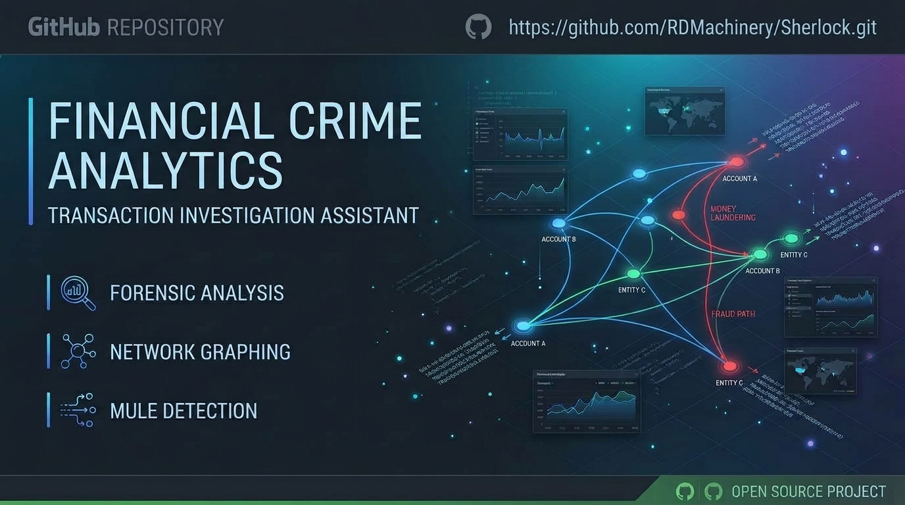

# Sherlock

**A transaction-analysis assistant for investigating online financial crime**: investment scams, romance scams, authorised push payment (APP) fraud, account takeover and money-mule networks.

Load bank or payment-provider exports and Sherlock will:

- rank the accounts that behave like mules or collection accounts;
- pick out the accounts that look like **victims**, for safeguarding;
- follow a victim's money forward to where it sits **now**;
- produce reports and graph exports for case files.

It is a single Java file with no dependencies.

```
java Sherlock.java demo demo.csv
java Sherlock.java demo.csv
sherlock> analyze
sherlock> trace ACC-VICTIM-01
sherlock> report case.html ACC-VICTIM-01
```

> **Sherlock produces investigative leads, not proof.** Every finding must be verified against original bank or provider records and handled under your force's evidence procedures.

---

## What's new in 2.0

Version 2.0 is a substantial rewrite. Every change below is covered by the built-in self-test (`java Sherlock.java selftest`, 59 checks).

### Correctness fixes

- **Strict amount parsing.** Version 1 silently read `1.234,56` as `1.23` and `(500.00)` as `+500`. Ambiguous amounts are now rejected with a reason, and `--decimal-comma` reads European formats correctly. Currency symbols and codes (`£1,234.56`, `GBP 100.00`) are understood.
- **Time zones.** `--tz Europe/London`, or `tz=` in a mapping file, sets the zone that zone-less timestamps are read in, and every output says which zone its times are shown in. Sherlock warns:
  - when zone-less times were read as UTC;
  - when a file mixes times with and without a zone;
  - when a local time falls in a clock change, either repeated in October or non-existent in March.
- **Selectable tracing rules.** `tainted-first` (the v1 behaviour, and still the default), `clean-first`, `fifo` and `prorata`. The rule is printed on every trace and report, and the new `compare` command shows all four side by side.
- **Loops must happen in time order.** A→B→C→A is only flagged when each hop follows the previous one within `cyclewindow`. Two-account round trips (A→B→A) are now detected as `ROUND_TRIP`. Small payments below `cyclemin` are ignored. If the search stops early, the output says so instead of failing silently.
- **Scores no longer inflate.** Each finding type counts once, at its highest weight, so an account sharing three devices scores 25, not 75.
- **CSV parsing.** Quoted fields may contain line breaks. Files that are not valid UTF-8 are read as windows-1252, which is common in UK bank exports and is what breaks `£` signs. An unclosed quote is reported.
- **Exact money.** Every amount is held in pence (`long`) and converted from `BigDecimal` with banker's rounding. Each trace ends with a reconciliation line that checks every penny is accounted for.

### Evidential output

- **Every finding cites transaction IDs**, and every trace line cites `file:line`.
- **Audit log.** Every command, setting change, file load and file written is timestamped, with the SHA-256 of each input and output. `audit` shows the log, and it is appended to every report.
- **Report stamps.** Each report records the tool version, Java version, analyst name, time zone, base currency, tracing rule and the full settings table.
- **Every skipped row** is listed with its reason (the `skipped` command, and in reports), not just the first ten.
- **Every output file's SHA-256** is recorded in the audit log, and printed when a report is written.

### New detectors

| Finding | What it means |
|---|---|
| `LIKELY_VICTIM` / `POSSIBLE_VICTIM` | Repeated payments to one payee, with scam-typical memo words ("fee", "tax", "unlock", "release", "invest", …) or a payee that is itself flagged. Listed separately for **safeguarding**, never as suspects. |
| `ACCOUNT_TAKEOVER` / `ATO_PAYEE` | A new device or IP on an account with an established history, quickly followed by a payment several times the account's usual size. The account holder goes on the safeguarding list; the payee gets a suspect finding. |
| `DORMANT_REACTIVATED` | An account silent for `dormantdays` that suddenly moves money. |
| `ROUND_AMOUNTS` | An intermediary account whose payments are mostly exact round sums (weak signal). |
| `REPEAT_AMOUNTS` | The same exact amount again and again in a short window (weak signal). |
| `WATCHLIST` | An account, IP or device from a loaded watchlist (for example, from previous cases). |
| `STRUCTURING` (extended) | Now checks **incoming** as well as outgoing payments, and accepts several thresholds (`set threshold 10000,25000`). |

### New features

- **Multi-victim tracing with attribution.** `trace ACC-V1 ACC-V2 ACC-V3` keeps each victim's money separately labelled and ends with a table of how much of each victim's money sits in each account. This is useful for restraint orders and compensation.
- **Reverse trace.** `reverse EXCHANGE-A` shows where the money an account received originally came from.
- **Several input files with de-duplication.** Load statements from several banks. When the sending and the receiving bank both record the same transfer, the two records are matched (same payer, payee, amount and currency, within `dedupewindow` hours) and merged rather than counted twice. Every merge is logged (`dupes`). Loading the same file twice is refused.
- **Column-mapping profiles** for real bank exports, including **statement-style files** (one account's statement with Paid out / Paid in columns). `java Sherlock.java maptemplate` writes a commented template.
- **Currency conversion** from a rates file, using the rate on or before each payment's date.
- **Graph exports.**
  - Graphviz DOT, of the whole case or only the traced money.
  - Entity and link CSVs for **i2 Analyst's Notebook** or **Gephi**.
  - A normalised, de-duplicated transaction CSV.
- **HTML report** with a **Sankey diagram** of the money trail, an activity chart, a cumulative-loss chart for victims, and light and dark themes.
- **Shell conveniences.**
  - Account names can be typed in any case or partially (`account m10`), with "did you mean" suggestions.
  - `findings <TYPE>` lists every finding of one type.
  - Detectors can be switched on and off (`detectors`, `disable round-amounts`).
  - `config` and `saveconfig` load and save settings files.
  - Arguments can be quoted.
- **Restructured code.** Detectors sit behind a `Detector` interface. All state lives in a `Case` object instead of static globals. A known-answer self-test is built in.

### Upgrading from 1.x

Most v1 commands and CSV files work unchanged, but some results differ:

- **Trace results.** The default tracing rule is still `tainted-first`, so v1 trace results are reproduced; on the demo data, EXCHANGE-A, EXCHANGE-B and EXCHANGE-C hold the same amounts as in v1.
- **Rows now skipped.** Rows whose amounts v1 misread (decimal commas, brackets) are now skipped with a reason. Check `skipped` after loading.
- **Scores change.** Duplicate finding types no longer add up, and loops out of time order are no longer flagged.
- **Command line.** The `id` column is now optional; missing IDs become `file:line`. `trace <account> <time>` still works, and `trace <account> since <time>` is the new form.

---

## Requirements

Java 11 or newer. No build step: `java Sherlock.java …` compiles and runs the single source file.

## Quick start

```bash
java Sherlock.java demo demo.csv            # write a demo case (investment scam + mule layering)
java Sherlock.java demo.csv                 # interactive shell
java Sherlock.java demo.csv analyze         # one-shot: any command can follow the file names
java Sherlock.java selftest                 # run the known-answer tests
```

The demo contains:

- a victim groomed into four payments of rising "fees";
- five more victims paying the same collection account;
- structuring just under £10,000;
- a laundering loop and three exits to exchanges;
- an account takeover;
- a mule account that had been dormant for five months;
- background noise.

## Command line

```
java Sherlock.java [options] <file.csv> [file2.csv ...] [command args...]
```

| Option | Effect |
|---|---|
| `--tz <zone>` | Time zone for zone-less timestamps and for display, e.g. `Europe/London`. |
| `--map <mapping.properties>` | Column-mapping profile for the files that **follow** it on the command line. |
| `--decimal-comma` | Read amounts like `1.234,56`. |
| `--base <CUR>` | Base currency (default `GBP`). |
| `--rates <rates.csv>` | Exchange rates for conversion to the base currency. |
| `--watchlist <file.csv>` | Known accounts, IPs and devices. |
| `--config <settings.properties>` | Load settings; other options on the line override it. |
| `--analyst <name>` | Name stamped on reports. |
| `--no-dedupe` | Do not merge cross-file duplicates. |

Example with two banks' records:

```bash
java Sherlock.java --tz Europe/London --analyst "DC Smith" \
     --map bank-a.properties victim-statement.csv \
     --map bank-b.properties mule-statement.csv \
     provider-export.csv
```

## Input formats

### Standard CSV

A header row is required. Column order doesn't matter, and extra columns are ignored.

| Column | Required | Notes |
|---|---|---|
| `timestamp` | yes | ISO-8601: `2026-03-02T09:00:00Z`, `2026-03-02T09:00:00+01:00`, `2026-03-02 09:00`, `2026-03-02`. Zone-less times use `--tz` (default UTC, with a warning). |
| `from`, `to` | yes | Account identifiers. Use the same identifier everywhere, e.g. sort code + account number. |
| `amount` | yes | Positive. `1,234.56`, `£1,234.56` and `GBP 1234.56` are all fine. |
| `id` | no | Defaults to `file:line`. |
| `currency` | no | Three-letter code; blank means the base currency. |
| `ip`, `device` | no | The **sender's** online-banking session. These drive the device and IP detectors. |
| `memo` | no | Payment reference. This drives the victim detector. |

### Mapping profiles (real bank exports)

```bash
java Sherlock.java maptemplate bank.properties     # write a commented template
```

A profile maps Sherlock's fields to the export's own column headers and describes its date format, zone, delimiter, decimal style and any title rows above the header. A **statement-style** export holds one account's statement, so the profile names the owner:

```properties
name=Example bank statement
owner=12-34-56 12345678
counterparty=Counterparty account
debit=Paid out
credit=Paid in
date=Date
time=Time
date.format=dd/MM/yyyy
time.format=HH:mm
tz=Europe/London
memo=Description+Reference
skiplines=2
```

- Instead of `debit`/`credit`, you can use a signed `amount` column (negative means money out), or `amount` plus a `direction` column with `direction.out=DEBIT,DR` and `direction.in=CREDIT,CR`.
- In statement mode, `ip`/`device` values are kept only on money **out**, because on incoming rows they describe the owner's session, not the sender's.
- Unknown keys are rejected so typos don't pass silently.

### Rates file

```csv
date,currency,rate
2026-03-01,EUR,0.85
2026-03-01,USD,0.79
```

`rate` is the value of one unit of the currency in the base currency. Each payment uses the latest rate on or before its date; Sherlock warns if it had to use a later one. Payments that cannot be converted are kept, and Sherlock warns that totals mix currencies.

### Watchlist file

```csv
type,value,note
account,ACC-M01,Op Example mule
device,DEV-77,seen in a previous case
ip,203.0.113.50,
```

## Commands

**Data**

| Command | |
|---|---|
| `summary` | Sources with SHA-256 hashes, mapping, encoding, zone, row counts, period, totals and warnings. |
| `load <file.csv> [mapping]` | Add another file mid-session. |
| `dupes` | Payments merged as duplicates across files, with any fields filled from the duplicate. |
| `skipped` | Every row that could not be loaded, and why. |
| `rates <file>` / `watchlist <file>` | Load rates or a watchlist mid-session. |

**Analysis**

| Command | |
|---|---|
| `analyze [all]` | Suspicion ranking (top 25, or all), then the safeguarding list. |
| `findings <TYPE>` | Every finding of one type, e.g. `findings STRUCTURING`. |
| `victims` | The safeguarding list on its own. |
| `links` | Clusters of accounts linked by shared device or IP. |
| `account <account>` | Profile: totals, active period, sources, IPs, devices, top counterparties, score and findings. |
| `timeline <account>` | Chronological history with running net position. |
| `detectors`, `enable <name>`, `disable <name>` | List detectors and switch them on or off. |

**Tracing**

| Command | |
|---|---|
| `trace <account> [account…] [since <time>]` | Follow one or more victims' money forward to where it is at the end of the data. |
| `tracetx <txid> [txid…]` | Trace from specific payments. |
| `compare <account> [account…]` | Where the money ends up under each of the four tracing rules. |
| `reverse <account>` | Where the money an account received originally came from. |

**Output**

| Command | |
|---|---|
| `report <file.txt\|file.html> [victim…]` | Full report. `.html` adds the Sankey diagram and charts. |
| `export dot <file.dot> [victim…]` | Graphviz graph of the whole case, or only the traced money. |
| `export csv <prefix> [victim…]` | `prefix-entities.csv` and `prefix-links.csv` for i2 or Gephi. |
| `export tx <file.csv>` | Normalised, de-duplicated transactions with their source file and line. |
| `audit [file]` | Show or save the audit log. |

**Settings:** `settings`, `set <name> <value>`, `config <file>`, `saveconfig <file>`, `help`, `quit`.

## Detectors and scoring

| Finding | Weight | Signal |
|---|---:|---|
| `WATCHLIST` | 40 | Account, device or IP on the watchlist |
| `PASS_THROUGH` | 30 | ≥ `passratio` of incoming money forwarded within `dwell` hours on average (FIFO-matched) |
| `SHARED_DEVICE` | 25 | ≥ `devicemin` accounts send from one device |
| `STRUCTURING` | 25 | ≥ `structmin` payments in or out just under a threshold, within `structwindow` hours |
| `FAN_IN` / `FAN_OUT` | 20 | ≥ `fanmin` distinct counterparties within `fanwindow` days |
| `ATO_PAYEE` | 20 | Received the large payment that followed a device change on the payer's account |
| `CIRCULAR_FLOW` | 15 | Part of a loop of three or more accounts, hops in time order |
| `DORMANT_REACTIVATED` | 15 | Silent for `dormantdays`, then a burst worth ≥ `passmin` within `burstdays` |
| `ROUND_TRIP` | 10 | Money sent to an account and sent back |
| `SHARED_IP` | 10 | ≥ `ipmin` accounts send from one IP (weaker: Wi-Fi, VPN, mobile NAT) |
| `ROUND_AMOUNTS` | 5 | An intermediary account moving mostly exact multiples of `roundunit` |
| `REPEAT_AMOUNTS` | 5 | ≥ `repeatmin` identical payments within `repeatwindow` days |

**Score** = the highest weight of each finding type, added up. HIGH is 60 or more, MEDIUM 30 or more, LOW below that. Scores are a triage aid. Businesses, charities and shared households can match these patterns.

**Safeguarding findings** are never added to the suspicion score:

- `LIKELY_VICTIM`: ≥ `victimmin` payments to one payee within `victimwindow` days, totalling ≥ `passmin`, with memo keywords or a flagged payee.
- `POSSIBLE_VICTIM`: memo keywords plus a flagged payee, or repeated payments.
- `ACCOUNT_TAKEOVER`: a new device or IP after at least `atohistory` payments, then a payment ≥ `atofactor` × the usual median within `atowindow` hours.

## Tracing rules

Sherlock replays every transaction in time order. Each account is a pool of labelled money, and each payment takes money out of the sender's pool according to the chosen rule. Untraced money in the victim's payments becomes that victim's label.

| Rule | Assumption |
|---|---|
| `tainted-first` | Traced money leaves first. Follows the most money outward; can overstate taint downstream. (The v1 behaviour, and the default.) |
| `clean-first` | Untraced money leaves first; traced money stays in each account as long as possible. |
| `fifo` | Money leaves in the order it arrived, as in the rule in Clayton's Case. |
| `prorata` | Every payment carries traced and untraced money in proportion to the balance at that moment. |

The choice matters. On the demo data, the collection account ACC-M01 receives £38,000 from VICTIM-01 and £10,000 from five other victims, then pays out £47,700:

```
sherlock> compare ACC-VICTIM-01
Account                 tainted-first    clean-first           fifo        prorata
EXCHANGE-A                  19,000.00       9,600.00      17,000.00      15,041.66
CRYPTO-WLT-9                     0.00       9,300.00       7,400.00       7,362.50
EXCHANGE-C                   9,200.00       9,300.00       7,500.00       7,362.49
EXCHANGE-B                   9,200.00       8,700.00       5,200.00       7,283.33
```

The legal rules for tracing mixed funds differ, so confirm the approach with the prosecutor before relying on any one column. Pro-rata splits use exact integer arithmetic with a largest-remainder rule, so pennies always reconcile.

For `reverse`, every pound carries an origin label: the account that first paid it out without having received it in the data. `tainted-first` and `clean-first` therefore behave pro rata there, and `fifo` remains distinct.

## Reports and exports

- **Text report**:
  - stamps and source hashes;
  - all settings, warnings, skipped rows and merges;
  - the full ranking with every transaction ID;
  - safeguarding list and clusters;
  - the trace with attribution;
  - the audit log.
- **HTML report**: the same content as summary tiles and tables, plus:
  - a **Sankey diagram** of the money trail, with victims, intermediaries and exit points colour-coded and loop-backs dashed;
  - an activity chart and a cumulative-loss chart;
  - a tracing-rule comparison.

  It is a single self-contained file that follows the viewer's light or dark preference.
- **Graphviz**: `dot -Tsvg traced.dot -o traced.svg`. Nodes are coloured by level, victims are green, exits are double-bordered, and edge width scales with value.
- **i2 / Gephi**: entities have `Id, Label, Type, Score, Level, Received, Sent, Findings`. Links have `Source, Target, Weight, Count, First, Last, TxIds`.

## Settings

Type `settings` to see every value. They can be changed with `set`, and saved or loaded as a properties file.

| Group | Settings (default) |
|---|---|
| Structuring | `threshold` (10000), `structband` (0.8), `structmin` (3), `structwindow` (72 h) |
| Pass-through | `passratio` (0.9), `passmin` (1000), `dwell` (48 h) |
| Fan-in / fan-out | `fanmin` (5), `fanwindow` (7 d) |
| Shared identifiers | `devicemin` (2), `ipmin` (3) |
| Loops | `cyclelen` (4), `cyclewindow` (168 h), `cyclemin` (1000) |
| Victims | `victimmin` (3), `victimwindow` (30 d), `keywords` |
| Account takeover | `atohistory` (3), `atowindow` (24 h), `atofactor` (3) |
| Dormant | `dormantdays` (60), `burstdays` (7) |
| Weak signals | `roundunit` (500), `roundratio` (0.8), `roundmin` (4), `repeatmin` (4), `repeatwindow` (30 d), `repeatminamount` (100) |
| Tracing and data | `tracemode` (tainted-first), `dedupe` (true), `dedupewindow` (48 h), `base` (GBP), `tz` (UTC), `decimalcomma` (false), `analyst` |

The default £10,000 structuring threshold is only a starting point. The UK has no fixed reporting threshold for transfers, so the limits worth testing are usually the banks' own per-payment or daily limits, and you can set several at once.

## Limitations

- **Data coverage.** Sherlock only sees the data you load. "Where the money is now" means at the end of that data; an account with no onward payments may simply have records you don't hold yet.
- **Matching across banks.** Cross-bank matching relies on consistent account identifiers. Statements that name counterparties by name, not number, will not match.
- **Device and IP signals.** These depend on the provider supplying session data, and shared IPs are weak evidence on their own.
- **Thresholds.** Detector thresholds are heuristics. Tune them to the case and record the settings used; every report does this for you.
